# BranchWorld

Welcome to BranchWorld! **Create a world. Fill it with life. Watch what it becomes.**

BranchWorld is a 3D living-world sandbox built with Kotlin Multiplatform. Set down animals and plants on a small island and watch them live on their own. Nothing is scripted.

Some handy links:

* [Play in the browser](https://hib4.github.io/BranchWorld/)
* [How to play](docs/PLAYING.md)
* [Building and running](docs/BUILDING.md)
* [Architecture](docs/ARCHITECTURE.md)
* [Assets and credits](docs/ASSETS.md)

## Features

* **Create** – Start from a named island or your own seed, empty or already wild.
* **Populate** – Set down rabbits, wolves, deer, foxes, trees and grass by hand.
* **Observe** – Animals graze, hunt, form packs and raise young. Tap one to see what it is doing and why.
* **Experiment** – Rewind to any moment, try another way, and compare the two histories.
* **Discover** – Every boom, crash and wildfire is recorded, with its causes.

## Kotlin Multiplatform

  

* **One set of rules** – The world's rules are pure common Kotlin and replay identically on every platform.
* **One interface** – Every screen is written once with Compose Multiplatform.
* **One scene** – The 3D world is described once; Kool draws it on Android, Desktop and the web, RealityKit on iOS.

## How to play

| Action | Touch | Mouse and keyboard |
| --- | --- | --- |
| Set down or select | Tap | Click |
| Orbit | Drag one finger | Drag, or arrow keys |
| Pan | Drag two fingers | Right-drag, or Shift and arrow keys |
| Zoom | Pinch | Scroll, or `+` and `-` |

Pick an animal or plant from the dock, then tap the island. Worlds save automatically. The full guide is in [docs/PLAYING.md](docs/PLAYING.md).

## Build environment requirements

* JDK 21
* Android SDK (API 37)
* Xcode with the Metal Toolchain, for iOS
* Git LFS – run `git lfs pull` after cloning

## Building

### Important Gradle tasks

* `./gradlew :desktopApp:run` – runs the Desktop app
* `./gradlew :androidApp:assembleDebug` – builds the Android APK
* `./gradlew :webApp:jsBrowserDevelopmentRun` – serves the web app locally
* `./gradlew :webApp:jsBrowserDistribution` – builds the static website

For iOS, open `iosApp/iosApp.xcodeproj` in Xcode and run the `iosApp` scheme.

See [docs/BUILDING.md](docs/BUILDING.md) for tests, devices and release builds.

## Contributing

* Read [AGENTS.md](AGENTS.md) and [PLAN.md](PLAN.md) first.
* Keep the rules deterministic so that every saved world replays exactly.
* See [where new code goes](docs/ARCHITECTURE.md#where-new-code-goes).
