# BranchWorld architecture

[← Back to README](../README.md)

BranchWorld follows a layered architecture: each layer depends only on the layers below it, and the deterministic rules sit in a module of their own so the compiler keeps the interface out of them.

Inside `:shared`, the interface sits on data, data on domain, and domain on the platform ports. Each platform plugs in through those ports. The apps handle startup, the window or page lifetime, and the platform adapters, and `:simulation` holds the deterministic rules, saves and render projections.

## `:simulation` — the world's rules (no Compose, no platform code)

| Package | What lives there |
|---|---|
| `core` | `GridCell`, `SplitMix64`, `CanonicalWriter`, `CreatureHeading`, and `RulesVersions.kt`: every rule set and world generator a save can name |
| `terrain` | Island generation, drainage, navigation |
| `ecology` | World state and the rules of each system: `environment`, `wildlife`, `range`, `life` (rules v12), `fire`, `settlement`, `chronicle`, `chapters` (the crafted chapters), `legacy` (rules v3–v6 animals) |
| `command` | `WorldCommand` and its tick-ordered queue: the player's acts, recorded in every history |
| `engine` | `EcologyEngine`: one step applies commands, growth and fire, then hands over to the rules era that finishes it (`finishLivingStep` for v12, `finishEarlierStep` for v3–v11) |
| `timeline` | Branches, replay, seeking and history browsing |
| `save` | Save codecs (schemas 1–10) and shareable world codes |
| `projection` | Read-only poses the renderer and interface draw: `WorldRenderProjection`, `LivingEchoProjection`, `WorldCamera`, `WorldPointer` |
| `runtime` | `WorldClock`, the coroutine that ticks a world at its chosen speed |
| `legacy` | Rules v1–v2 (the first walking rabbit) |

Living worlds run rules v12 in `ecology/life`. `LifeRules` runs each step over its collaborators:
- `LifeGround` holds what the animals perceive, plus movement.
- `LifePlacement` checks the player's hand.
- `PreyBehaviour`, `PredatorBehaviour` and `EverydayNeeds` decide what each animal does.

Each creature decides from what it could perceive on the previous tick and draws counter-based random rolls, so the result never depends on processing order. Earlier rule sets stay so that saves made with them keep replaying exactly. Their replay hashes are pinned in the tests, so a refactor that changes any history fails the build.

## `:shared` — the game around the rules

| Layer | What lives there |
|---|---|
| `platform` | Ports each host implements, bundled in `AppServices`: `WorldViewport` (3D view), `WorldSoundPlayer`, `PhotoSaver`, `WorldSaveStore`. Also the shared code the hosts reuse: `KeyedWorldSaveStore` over a tiny `BlobStorage`, the save layout (`island-v3.json`, `worlds/<name>`) and `AmbienceGlide` |
| `domain` | `IslandSessionKey` (which world), autosave and soundscape policy, `WorldInteraction` (what a tap of the hand does), and `session/`. `IslandLoad.Ready` joins one `WorldSessionCore` with role classes: `WorldPlacement`, `HistoryNavigation`, `BranchComparing`, `ChapterControls` |
| `data` | `WorldRepository` (open, cache, autosave, import), `ProfileRepository`, `PlayerProfile` |
| `ui` | `app` (`App`, `AppViewModel`, navigation, layout), `theme`, `components`, `home`, `share`, `world` (HUD, panels, inspector, timeline, comparison, echo, history) and `legacy` (the earlier chapters' screens and HUD) |

`App(services, foreground)` is the whole contract with a host. The world screen keeps its momentary state in `WorldScreenState`, and its side effects (clock, taps, sound) live in `WorldEffects`.

## `:renderer` — the 3D view behind the `WorldViewport` port

Kool draws the world on Desktop (Vulkan), Android (GLES) and the web (WebGL 2). Kool has no iOS backend, so iOS draws with RealityKit. Everything that decides what is drawn is shared Kotlin, and both engines draw the same arrays:

| Source set | What lives there |
|---|---|
| `commonMain` (every target, iOS included) | `camera` (`PreviewController`, `PreviewCamera`, `GroundPicking`, `FocusFraming`), `input` (`TouchGestureTracker`), `geometry` (terrain chunks, sea, pines, landscape details, water, reeds, fire, echoes, life shapes as plain arrays), `lighting` (`CoastalLight`), `motion` (`CreatureMotion`, `CreaturePacing`), `assets/gltf` (a glTF reader and `ClipSampler`), `hud` |
| `koolMain` (jvm, android, js) | `scene`: `DioramaSession` and the Kool meshes and KSL shaders built from the shared geometry; `diagnostics` |
| `skikoMain` (jvm, js, ios) | `pointerCameraInput`: mouse, wheel, keys and touch through Compose |
| `iosMain` | `IosDiorama` and `WorldStage`, the interface the Swift RealityKit stage implements, plus `stage/`, which uploads the shared geometry and glTF models and poses every entity each frame |

`DesktopDiorama` (Vulkan into Compose), `AndroidDiorama` (GLES), `WebDiorama` (WebGL 2 beneath a transparent Compose canvas) and `IosDiorama` (RealityKit in a `UIKitView` beneath Compose) each implement `WorldViewport`. The Kool meshes are built from the shared geometry with the exact vertex data they had before. On iOS, `iosApp/iosApp/World/RealityWorldStage.swift` turns the Kotlin data into RealityKit entities, and `WorldShaders.metal` ports the Kool shaders: lighting, haze, sea, rivers, wind, fire. The shaders convert sRGB to Display P3 and flatten RealityKit's tone curve (iOS 27), so the island matches the other platforms.

`:iosKit` builds the `Shared` framework that the Xcode project links. It holds `MainViewController(stage:)` and the iOS adapters:
- `IosWorldSaveStore` keeps saves in Application Support in the shared layout.
- `IosWorldSounds` plays the cues and the layered soundscape with `AVAudioPlayer` in the ambient audio category, so it mixes with the player's music and follows the silent switch.
- `IosPhotos` adds photos to the photo library. It asks only for add-only access (`NSPhotoLibraryAddUsageDescription`) and offers the share sheet afterwards.

## Per platform

| Platform | 3D view | Worlds are saved in | Photos go to |
| --- | --- | --- | --- |
| Android | Kool (OpenGL ES) | The app's private files | The `Pictures/BranchWorld` album |
| Desktop | Kool (Vulkan) | The user's application data folder | `~/Pictures/BranchWorld` |
| Web | Kool (WebGL 2) | The browser's IndexedDB | The browser's downloads |
| iOS | RealityKit | Application Support | The photo library |

## Where new code goes

| Change | Where it goes |
|---|---|
| A new rule | Its system's package in `:simulation`, behind a new entry in `core/RulesVersions.kt` |
| A new player act | A `WorldCommand` with an explicit `@SerialName` |
| What the interface does with a world | `domain/session` |
| Storage, sound or photos for a platform | A new adapter for an existing port |
| A screen | Its feature folder under `ui` |
| Something new in the 3D world | Its shape in `renderer/commonMain/geometry`, then a Kool mesh in `koolMain/scene` and a stage slot in `iosMain/stage` (plus a shader in `WorldShaders.metal` when it needs one) |

